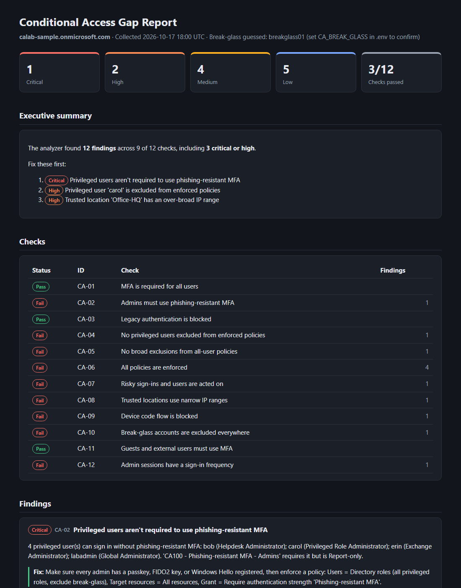
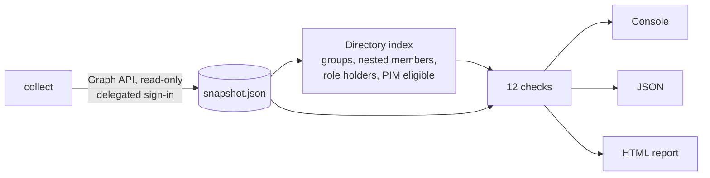

# CA Gap Analyzer

[](https://github.com/wesleyy720/ca-gap-analyzer/actions/workflows/tests.yml)


**Finds the security gaps hiding in Microsoft Entra ID Conditional Access.**

Most Conditional Access reviews happen by hand in the portal, one policy at a time. The real
gaps hide *between* policies: an admin tucked into a "temporary" exclusion group, a policy left
in Report-only for months, a "trusted" location covering 16 million IP addresses. This tool
reads a tenant's configuration through Microsoft Graph (read-only), resolves every group and
role to the people behind it, and reports what an attacker could get through.


<sub>Report generated from the synthetic sample tenant in `samples/`.</sub>

## What it found in a lab tenant

Run against a lab tenant built with deliberate (and some accidental) misconfigurations, it
reported 14 findings, including:

- **A Global Administrator excluded from MFA and from the legacy-auth block.** The account was
  excluded both directly and through an exclusion group, so a password alone was enough to sign
  in, even over IMAP.
- **A Privileged Role Administrator hiding in an exclusion group.** The portal shows only the
  group name; the tool expands the group to its members and checks their roles.
- **Four admins without phishing-resistant MFA,** because the policy requiring it targeted only
  one role and was still in Report-only.
- **A "trusted" office location of `20.0.0.0/8`,** much of it public cloud IP space that anyone can rent.

## The 12 checks

| ID | Check | Why it matters |
|----|-------|----------------|
| CA-01 | MFA required for all users | Password spray works against any account without it |
| CA-02 | Admins use phishing-resistant MFA | Push and code MFA can be relayed by adversary-in-the-middle kits |
| CA-03 | Legacy authentication blocked | Legacy protocols can't do MFA at all |
| CA-04 | No privileged users excluded | Exclusions silently switch policies off for that person |
| CA-05 | No broad exclusions | "All users" minus most of them is false assurance |
| CA-06 | Policies are enforced | Report-only and disabled policies protect nothing |
| CA-07 | Risk-based policies enforced | Identity Protection risk scores do nothing on their own |
| CA-08 | Trusted locations are narrow | Broad trusted ranges let attackers skip controls |
| CA-09 | Device code flow blocked | Device code phishing is widely abused |
| CA-10 | Break-glass accounts set up correctly | A bad policy shouldn't be able to lock out every admin |
| CA-11 | Guests must use MFA | Partner tenants may have weaker security |
| CA-12 | Admin sign-in frequency | Long-lived admin sessions widen the token-theft window |

Every finding includes the affected users or policies, a concrete fix, MITRE ATT&CK techniques,
and a KQL query for Microsoft Sentinel pre-filled with the affected accounts. Full detection
logic: [docs/CHECKS.md](docs/CHECKS.md).

## How it works



1. **Collect** signs in as a read-only account and saves the tenant's policies, named
   locations, role assignments (active and PIM eligible), and the members of every group a
   policy references, including nested groups. Only referenced objects are collected.
2. **Analyze** answers "does this policy really apply to this person?" the way Entra does at
   sign-in: expanding groups and roles, applying exclusions, and treating Report-only and
   narrowing conditions as gaps.
3. **Report** writes console, JSON, or a self-contained HTML report.

Snapshots are plain JSON in Graph's own format, so analysis is repeatable, works offline, and
can be compared over time.

## Security model

- **Read-only.** Delegated Graph scopes only: `Policy.Read.All`, `Directory.Read.All`,
  `RoleManagement.Read.Directory`. Intended to run as a Global Reader.
- **No secrets.** Public client with interactive browser sign-in, so there's no client secret
  to leak. The app registration leaves "Allow public client flows" off, and the tool doesn't use
  device code flow (see CA-09).
- **Data minimization.** Directory objects are trimmed to the fields needed to name them.
- **Tenant data stays local.** Snapshots and reports go to git-ignored folders.
- **Safe reports.** All tenant text is HTML-escaped, since display names are
  attacker-controllable, and reports load nothing from the internet.

## Quickstart (sample data, no tenant needed)

```powershell
py -3.12 -m venv .venv
.\.venv\Scripts\python.exe -m pip install -e ".[dev]"
.\.venv\Scripts\ca-gap-analyzer.exe analyze samples\lab_snapshot.json
.\.venv\Scripts\ca-gap-analyzer.exe report samples\lab_snapshot.json --open
```

`policies` describes each policy in plain English, with exclusion groups expanded to their members:

```powershell
.\.venv\Scripts\ca-gap-analyzer.exe policies samples\lab_snapshot.json
```

## Analyze a live tenant

1. Create the read-only app registration ([docs/SETUP.md](docs/SETUP.md), Phase 2).
2. Copy `.env.example` to `.env` and fill in your tenant ID and client ID. Optionally list your
   break-glass accounts in `CA_BREAK_GLASS`, so the identity checks know those exclusions are
   intentional.
3. Collect, analyze, and report:

```powershell
.\.venv\Scripts\ca-gap-analyzer.exe collect --analyze --report
```

A browser window opens for sign-in. Use a Global Reader or Security Reader account. With no
path, `analyze`, `policies`, and `report` use the newest snapshot in `exports/`.

## Project layout

```
src/ca_gap_analyzer/
  auth.py, graph.py, collect.py   sign-in, Graph client (paging, throttling), collection
  snapshot.py, directory.py       snapshot loading; who-is-this-GUID lookups
  policy.py, coverage.py          policy wrapper; "does this policy apply to this user?"
  privileged.py, breakglass.py    privileged roles; break-glass designation or guess
  checks/                         one module per check (CA-01 ... CA-12)
  report.py, guidance.py          HTML report; ATT&CK mappings and KQL queries
tests/                            140+ tests, no network needed
samples/lab_snapshot.json         synthetic tenant used by tests and the screenshot
docs/                             setup guide, check catalog, roadmap
```

## Docs

- [Lab tenant setup](docs/SETUP.md): build a safe lab tenant and a read-only app registration
- [Check catalog](docs/CHECKS.md): every check, why it matters, and how it's detected
- [Roadmap](docs/ROADMAP.md): milestones and what's next

## License

[MIT](LICENSE)
